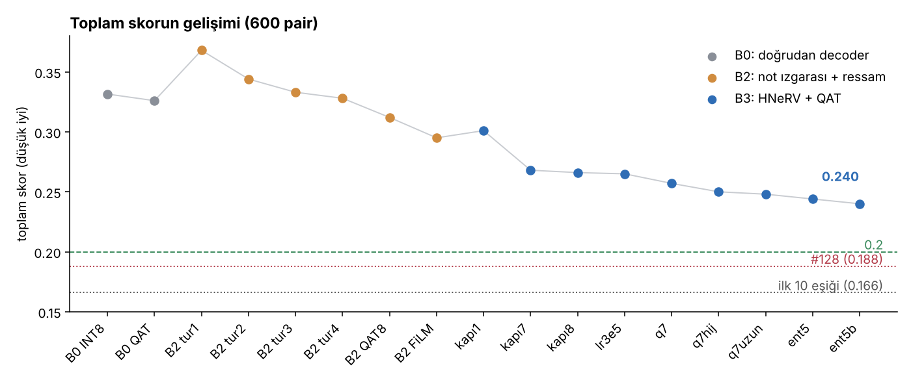
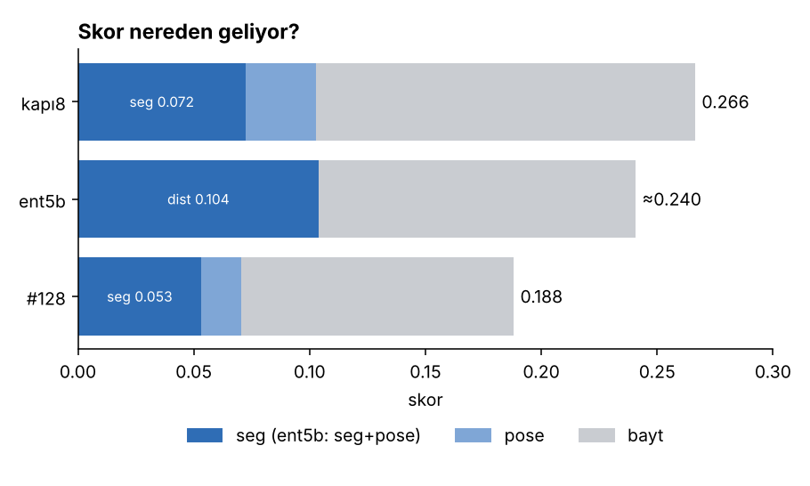
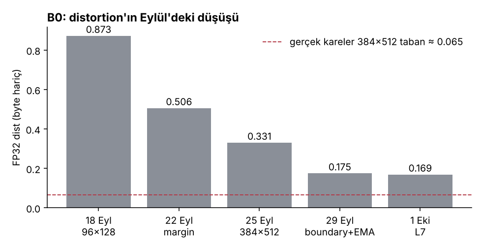
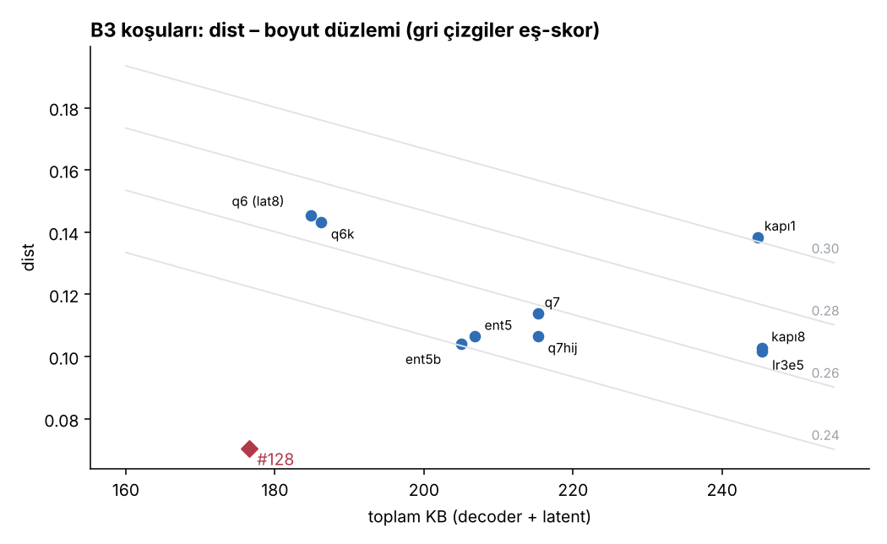
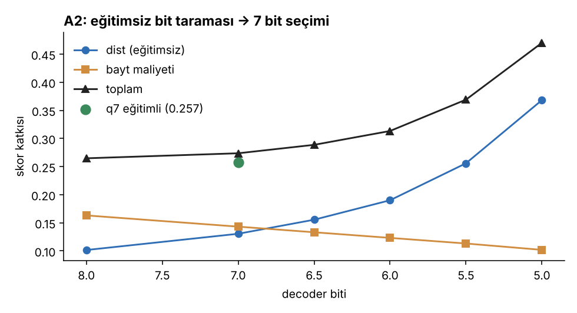
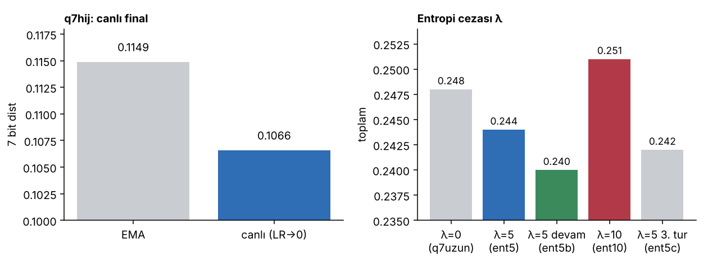
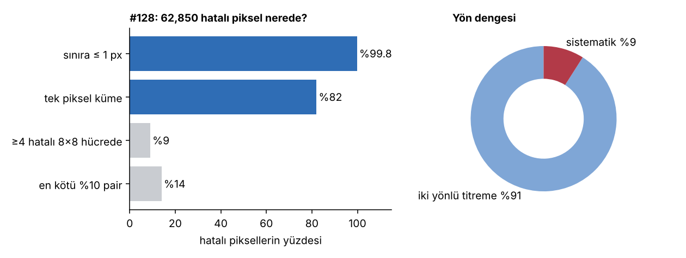

# commaOwnTry

[comma video sıkıştırma challenge'ı](https://github.com/commaai/comma_video_compression_challenge) için kendi modellerimle yaptığım denemelerin raporu. Eylül–Ekim 2026, Colab A100.

> **English abstract.** Research log of my own attempts at the comma video compression challenge. I train a small HNeRV-style implicit decoder (~243K params, 36-dim latent per frame pair) with 7-bit quantization-aware training, an entropy penalty and task losses through the frozen SegNet/PoseNet. My best model reaches **0.240** total score (dist ≈ 0.104, ~205 KB), down from 0.33 in September. I also reproduced the public #128 submission exactly (0.18796) and measured that the remaining segmentation error of this model family is symmetric 1-pixel boundary jitter, which is why cheap post-hoc fixes cannot pay for their bytes. This is not a challenge submission.



## Özet
- **En iyi modelim:** `b3_ent5b`, toplam **0.240** (dist ≈ 0.104, ~205 KB). Dosya [`models/b3_ent5b.pt`](models/).
- **Yol:** 0.33 (Eylül, düz INT8) → 0.295 (B2, not ızgarası) → 0.240 (B3, HNeRV + 7 bit QAT + entropi cezası).
- **Referans:** HNeRV ailesinin en iyisi #128'i resmi CPU değerlendirmesiyle birebir yeniden ürettim: 0.18796.
- **Kendi bulgularım:** canlı final EMA'yı geçiyor; λ skordan türetilebiliyor; bu ölçekte budama ölü; HNeRV'in seg tabanı yönsüz 1 piksellik sınır titremesi.
- **Sırada:** #128'den kendi modelime damıtma (B4). Amaç kendi modelimle 0.2 altı.

## Skor
```
skor = 100 · seg + √(10 · pose) + 25 · bayt / 37,545,489
```
`seg` SegNet'in uyuşmayan piksel oranı, `pose` PoseNet MSE'si. 1 KB ≈ 0.00067 skor. Değerlendirici ağlar donmuş; video 1200 kare = 600 pair.



Skorun yarıdan fazlası bayt. #128 ile aramdaki farkın çoğu dist'te (0.104 vs 0.070); bayt farkı ~28 KB ≈ 0.019.

## Süreç

### B0 (17 Eyl – 4 Eki): doğrudan decoder
96×128 bir codec'le başladım (dist 0.87), 384×512 sinüslü doğrudan decoder'a geçtim, margin / boundary / L7 kayıplarıyla FP32 dist'i 0.169'a indirdim. Düz INT8'e çevirince toplam 0.33 oldu: nicemleme açığı dist'ten büyüktü.



Bu dönemde denediğim ve kapattığım şeyler: SegNet sınıf maskeleri + boyacı ağı (FP32 0.0999'a indi ama maske ~105 KB'ın altına sıkışmadı), sinüs → GELU geçişi, HNeRV makale mimarisi, sınıf ağırlıklandırma, detail head. Bir de bf16 hatası buldum: eğitimde değerlendiricileri bf16 çalıştırıp FP32 ölçünce o dönemin QAT sonuçları geçersiz çıktı.

### B2 (5 – 16 Eki): not ızgarası + ressam
Pair başına çok ölçekli tamsayı "not" ızgaraları (entropi kodlu) ve küçük ortak bir "ressam" ağı. Oran–bozulma eğitimi, devam turları, QAT8 ve FiLM kodlarıyla 0.295'e indim. Duvarı şu gösterdi: 600 pair'de notların %97–98'i sıfırdı, bilgi zaten ressama kayıyordu. Bu beni decoder ağırlıklı yapıya (B3) götürdü.

### B3 (16 – 26 Eki): HNeRV + QAT
Eylül'deki 36 latentli sinüslü decoder'ı aldım ve uzun QAT turlarıyla eğittim. Eylül'de "sinüslü decoder düşük bite dayanmıyor" diye kapattığım yol yanlış kapatılmış: o hüküm 50–80 epoch'luk koşulara dayanıyordu.



Bit seçimini eğitimsiz bir taramayla yaptım (A2) ve tahmin 7 bitte tuttu:



Son iki adımı canlı final ve ağırlık entropi cezası getirdi:



### Ajan araştırmaları (26 – 30 Eki)
Claude Code üzerinde bir araştırma ajan sistemi kurdum ([commaArastirma](https://github.com/wHamza/commaArastirma)). Sonuç: kendi zincirimle 0.2 altı ancak #95 tarifini sıfırdan üretmekle mümkün (~53–70 A100 saati), en ucuz yol #128'i alıp cilalamak.

### #128 cilası (30 Eki): kapandı
#128'i birebir yeniden ürettim, sonra ucuz cilaları denedim: kare-0 artığı, kanal bias araması, seg yamaları. Hiçbiri kazanç vermedi. Nedeni seg hatalarının yapısı:



Hatalı piksellerin %99.8'i sınıf sınırına ≤ 1 px, %82'si tek piksel ve iki yön dengeli. Bir pikseli düzeltmenin skor değeri (~10 bit) konumunu kodlamaktan (~12 bit) düşük; yanlılık da olmadığı için ortak bir düzeltme de işe yaramıyor.

### B4 (31 Eki –): damıtma
Hipotezim: benim dist'im (0.104) ile #128'inki (0.070) arasındaki fark kapasite değil, havza. Modelim #128'den küçük değil (latent 36 ≥ 28). #128'in çıktısını öğretmen alıp kendi modelime damıtıyorum, sonra 7 bit QAT + entropi cezasıyla bitiriyorum. Notebook hazır, henüz koşmadım.

Ayrıntılı kronoloji: [`docs/surec.md`](docs/surec.md) · bulgular ve olumsuz sonuçlar: [`docs/bulgular.md`](docs/bulgular.md) · #128 denemeleri: [`docs/128-cila.md`](docs/128-cila.md)

## Bulgularım
| # | Bulgu | Kanıt |
|---|---|---|
| 1 | QAT'lı küçük INR'de LR→0'da **canlı model EMA'yı geçiyor** | q7hij: 0.1066 vs 0.1149 dist |
| 2 | Katman kırılganlığı bayta orantılı; istisna SegNet'in gördüğü `rgb_1` | A1: 0.1 KB için +0.008 dist |
| 3 | QAT eğitimsiz açığın ~0.43–0.46'sını bırakıyor → eğitimsiz tarama bit seçimini tahmin ediyor | A2 → q7 (tahmin 0.258, gerçek 0.257) |
| 4 | **λ skordan türetilebilir** (eğitim kaybı / dist ≈ 5) | ent5: 0.248 → 0.244, ent5b 0.240 |
| 5 | Entropi kodlu küçük ağda **budama ölü** | A3: %10 budama +0.039 dist / −5.8 KB |
| 6 | HNeRV'in seg tabanı **yönsüz 1 px sınır titremesi** | #128: %99.8 ≤ 1 px, sistematik %9 |
| 7 | #128 ucuz cila için **yerel optimumda** | K1, kanal bias, K3 sıfır/negatif |

## Repo
```
README.md                         bu rapor
models/b3_ent5b.pt                en iyi modelim (0.240)
models/README.md                  biçim, yükleme, ölçüm
notebooks/b3_ressam600_v1.ipynb   B3: QAT turları, bit taraması, budama, entropi cezası (çıktılarıyla)
notebooks/b4_damitma_v1.ipynb     B4: #128'den damıtma (henüz koşulmadı)
notebooks/gecmis/                 eski denemelerin notebook'ları (aşağıda)
docs/surec.md                     koşu koşu kronoloji
docs/bulgular.md                  bulgular ve olumsuz sonuçlar
docs/128-cila.md                  30 Ekim #128 denemeleri
docs/img/                         grafikler + üreten betik (grafikler.py)
```

### Eski notebook'lar (`notebooks/gecmis/`)
| Dosya | Tarih | Ne |
|---|---|---|
| `01_2309_direct_decoder_pilot` | 23–30 Eyl | 384×512 doğrudan decoder ilk pilotu, sınıf başına seg teşhisi |
| `02_3009_direct_decoder_pilot2` | 30 Eyl – 4 Eki | düzenli sürüm: L7, maskeler, ilk QAT, bf16 teşhisi |
| `03_3009_hnerv2_e192` | 30 Eyl | HNeRV makale mimarisi (16×3×4 embedding): RGB ön eğitim + görev aşaması |
| `04_0510_b1_gelu` | 5 Eki | sinüs → GELU denemesi ve B2'nin ilk 60 pair pilotu |
| `05_0610_kahin_deneyi` | 6 Eki | kâhin deneyi: SegNet gerçek haritadan üretilen basit görüntüleri ne kadar okuyor (tavan ölçümü) |
| `06_0910_b2_temiz_v2` | 9 Eki | B2 temiz sürüm: FP32 → bit aşaması → ressam ince ayarı |
| `07_1110_b2_tezgah120_v4` | 11 Eki | 120 pair test tezgâhı, #95 dersleri, QAT8 ressam (0.312) |
| `08_1510_b2_tezgah600_v5` | 15 Eki | 600 pair, FiLM kodları (0.295) |
| `09_1610_b2_tezgah600_v6` | 16 Eki | zamansal entropi, kanal cerrahisi, λ taraması |

Notebook'lar Drive'da `deneme/` klasörünü (değerlendirici ağırlıkları, `0.mkv`, hedef önbelleği) bekliyor; yollar ilk hücrelerde.

## İlgili
- Ajan tabanlı yol araştırması: [wHamza/commaArastirma](https://github.com/wHamza/commaArastirma)
- Karşılaştırma ve damıtmada kullandığım kamu gönderimleri: challenge PR #95 ve #128 (MIT). Ağırlıkları bu repoda yok; B4 notebook'u kurulumda indiriyor.

## Not
Bu repo yüksek lisans tez çalışmamın deney kaydı, challenge gönderimi değil. Notebook'ları, dokümanları ve grafikleri Claude (Anthropic) yardımıyla hazırladım.
