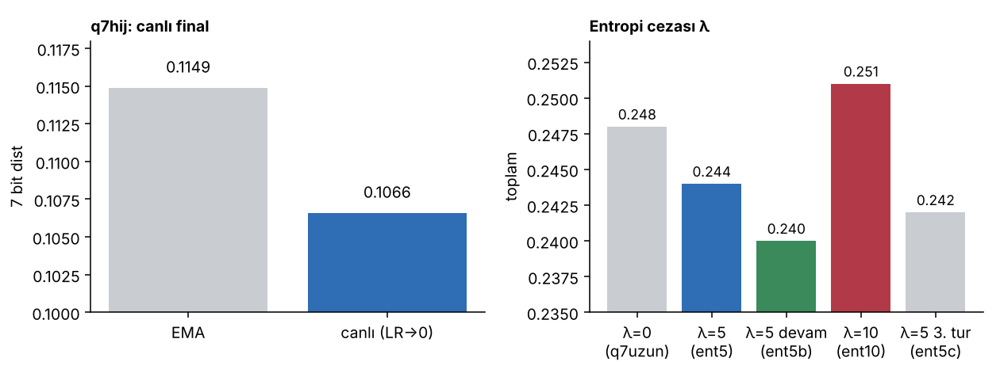
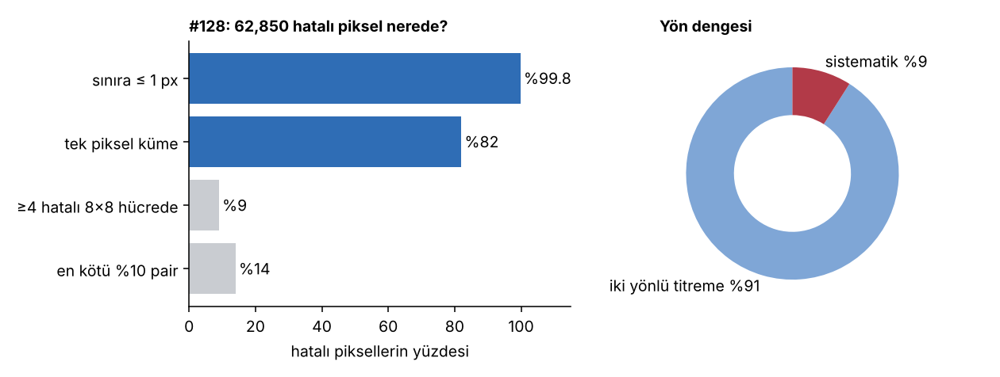

# Bulgular

Literatürden aldığım araçlar (QAT/STE, entropi kodlama, EMA, oran–bozulma cezası) değil, bu problemde kendim ölçtüklerim.

## Olumlu
1. **Canlı final.** QAT'lı küçük INR'de LR→0'da canlı model EMA'yı geçiyor: dist 0.1066 vs 0.1149. Altı koşunun hepsinde gördüğüm "son epoch kötüleşmesi" yalnız EMA ölçümünden geliyormuş. Mekanizma: LR≈0'da salınım durur, eşikteki ağırlıklar tutarlı tarafa yerleşir.
2. **Görev farkındalıklı kırılganlık haritası.** Bir katmanı nicemlemenin dist maliyeti baytıyla aşağı yukarı orantılı. İstisna `rgb_1` (SegNet'in gördüğü kare): 0.1 KB için +0.008 dist. Derin bloklar bayt başına daha kırılgan.
3. **Eğitimsiz → eğitimli kalibrasyon.** QAT eğitimsiz nicemleme açığının 6 bitte 0.46'sını, 7 bitte 0.43'ünü bırakıyor. Eğitimsiz tarama × bu çarpan, pahalı koşu olmadan 7 bit seçimini doğru tahmin etti.
4. **λ skordan türetilebilir.** Eğitim kaybı / gerçek dist ≈ 5, dolayısıyla λ≈5 baytın skordaki fiyatı. İlk denemede 0.248 → 0.244, devamıyla 0.240. λ=10 daha kötü (0.251).

## Olumsuz (denedim, işe yaramadı)
| Deneme | Sonuç | Neden |
|---|---|---|
| Budama %10 | net zarar | entropi kodlu küçük ağda küçük ağırlıklar zaten ucuz; fazlalık yok |
| 6 bit decoder | 7 bitin gerisinde doygun | dist maliyeti kazanılan baytı aşıyor |
| Eğitimsiz 6→8 bit yükseltme | dist artıyor | QAT'lı ağ kendi ızgarasına uyum sağlamış; ters test bilgi vermez |
| Yüksek LR'de entropi cezası (hlr) | kararsız | doğrusal çekirdekli yumuşak histogram yüksek LR'de patlıyor |
| SegNet sınıf maskeleri (Eylül) | FP32 0.0999 ama toplamda zarar | maske kayıpsız ~105 KB'ın altına inmedi |
| Sinüs → GELU | dist 0.33 → 0.67 | alfa arttıkça bozuldu, durdurdum |
| B2 ızgara mimarisi | 0.295'te durdu | kaba seviyeler %97–98 sıfır; KB ızgaralarda |
| #128 üzerinde cila (K1, kanal bias, seg yamaları) | sıfır / negatif | bkz. [128-cila.md](128-cila.md) |

## Yaptığım hatalar ve dersleri
- **bf16 eğitim / FP32 ölçüm uyuşmazlığı** o dönemin QAT sonuçlarını geçersiz kıldı → eğitim ölçümle aynı hassasiyette.
- **Kısa koşuyla yol kapatmak:** sinüslü decoder'ı 50–80 epoch'luk QAT'a bakıp kapatmıştım; 12,000 epoch'ta FP32 kaynağın altına indi.
- **Tek koşuda iki değişken** (q6'da latent de 6 bit oldu) → her pilot tek şeyi değiştirir.
- **Yalnız EMA ölçmek** canlı finali gizledi → her ölçümde ikisi birden.

## HNeRV ailesinin seg tabanı
#128 üzerinde ölçtüm (30 Ekim):

- 62,850 uyuşmaz pikselin **%99.8'i** gerçek sınıf sınırına ≤ 1 px; **%82'si** tek pikselli küme; en büyük küme 8 px.
- Hataların %54'ü sınıf 0 ↔ 1 (şerit sınırı). Her sınıf çiftinde iki yön dengeli; **tek yönlü (sistematik) kısım yalnız %9**.
- Bir hatalı pikselin skor değeri (~10 bit) konumunu kodlamanın maliyetinden (~12 bit) düşük. Yerel düzeltme kendini ödeyemez; yanlılık olmadığından sıfır baytlık ortak düzeltme de çalışmaz.
- Sonuç: seg'i düşürmenin yolu sınırları alt-piksel doğrulukla temsil etmek. Kesin harita saklayan semantik token ailesinin ~0.012 seg'e inip HNeRV'in ~0.05'te durmasının açıklaması bu.
